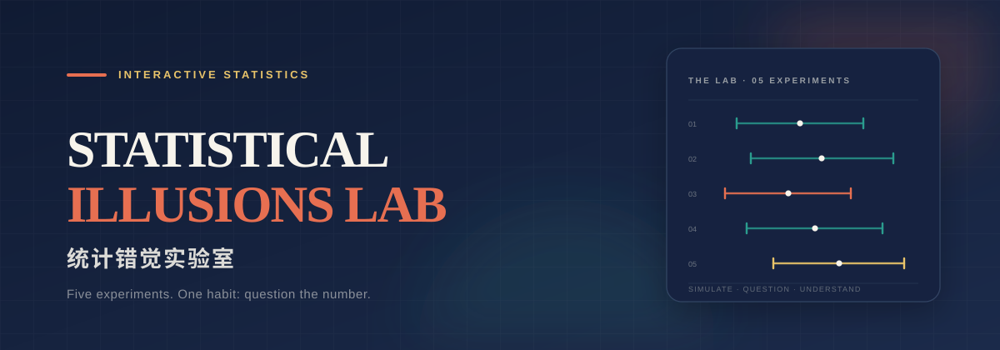
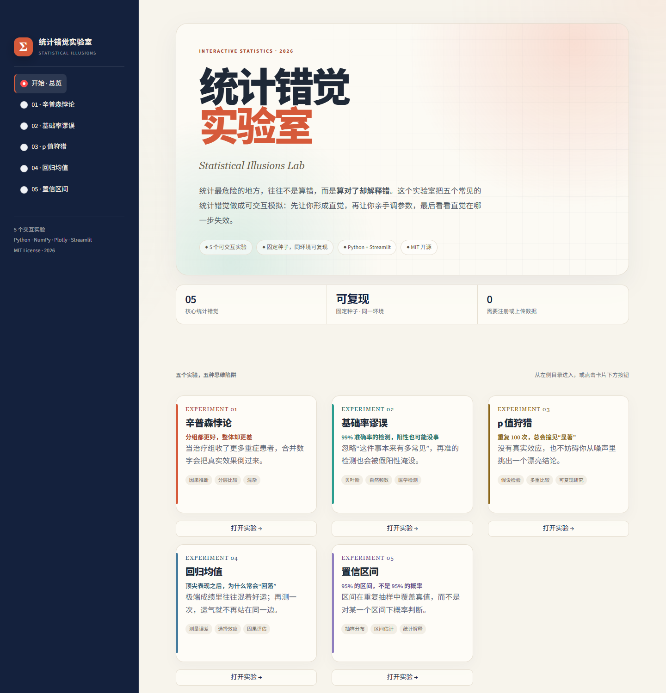
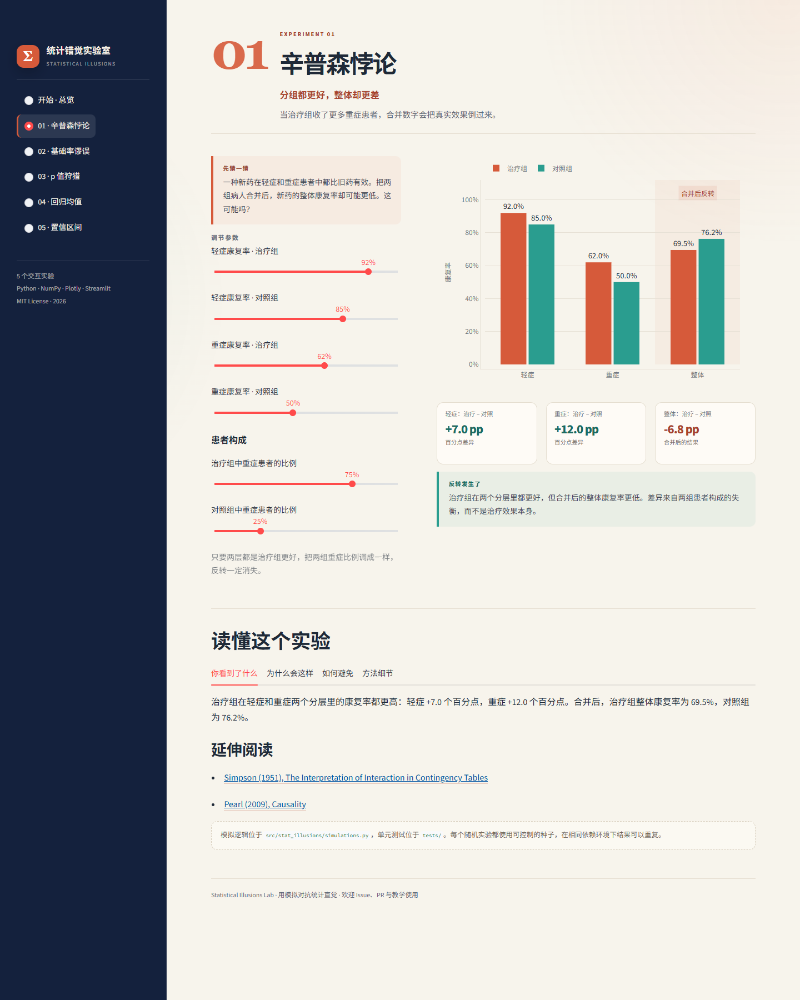

<p align="center">
  
</p>

<h1 align="center">统计错觉实验室</h1>

<p align="center">
  <strong>用可交互模拟，拆穿统计直觉的错觉。</strong><br>
  五个实验，五种“算对了却解释错”的瞬间。
</p>

<p align="center">
  <a href="https://stat-illusions-lab.streamlit.app/">
    
  </a>
  <a href="https://github.com/jiezhou9/stat-illusions-lab/actions/workflows/ci.yml">
    
  </a>
  
  
  
</p>

> 统计最危险的地方，往往不是算错，而是**算对了却解释错**。
> 这个项目把常见的统计错觉做成可调参数的互动实验：先让你形成直觉，再让你亲手把它推翻。

**在线试用**：[stat-illusions-lab.streamlit.app](https://stat-illusions-lab.streamlit.app/)

[English README](README.en.md) · [方法说明](docs/methods.md) · [发布清单](docs/publishing.md) · [参与贡献](CONTRIBUTING.md)

---

<p align="center">
  
</p>

<p align="center">
  <sub>首页：五个实验、可复现模拟，以及“解释优先”的设计。</sub>
</p>

## 为什么做这个项目

很多统计错误不是因为公式不会，而是因为直觉太快：

- 看到“整体更差”，就以为每个分组都更差；
- 看到“检测准确率 99%”，就以为阳性几乎等于患病；
- 看到 `p < 0.05`，就以为发现了真实效应；
- 看到“顶尖选手回落”，就以为他们退步了；
- 看到“95% 置信区间”，就以为参数有 95% 的概率落在里面。

这个实验室不急着给公式。它先给你一个反直觉的场景，让你调参数、看分布、观察结论如何翻转；然后再解释机制、误区和避免方法。

**目标用户**：统计初学者、数据从业者、A/B 测试实践者、统计与数据科学课程的教学者。

## 五个实验

| # | 实验 | 你会看到什么 | 核心概念 |
|---|------|--------------|----------|
| 01 | **辛普森悖论** | 治疗组在每个分层里都更好，合并后却更差 | 混杂、分层比较、因果推断 |
| 02 | **基础率谬误** | 灵敏度 99%、特异度 95% 的检测，阳性者只有约 17% 真的患病 | 贝叶斯公式、自然频数、阳性预测值 |
| 03 | **p 值狩猎** | 100 次完全无效的 A/A 实验里，仍然出现若干“显著”结果 | 多重比较、族错误率、p-hacking |
| 04 | **回归均值** | 选出第一次成绩前 10% 的人，第二次平均分明显回落 | 测量误差、选择效应、极端组 |
| 05 | **置信区间** | 重复抽样 100 次，约 95 个区间覆盖真值，但不是每个区间都有 95% 的概率 | 抽样分布、区间估计、频率派解释 |

每个实验都包含：可调参数、可复现的随机模拟、即时反馈、机制解释、常见误区和延伸阅读。

### 方法一览

| 实验 | 模型 | 展示/估计 | 关键假设 |
|------|------|-----------|----------|
| 辛普森悖论 | 分层康复率按患者构成加权 | 分层率 vs 合并率 | 图中为期望率，不含抽样误差 |
| 基础率谬误 | 贝叶斯公式与自然频数 | PPV、假阳性占比 | 灵敏度/特异度固定，检测条件独立 |
| p 值狩猎 | 独立 A/A 实验的双侧 z 检验 | p 值分布、FWER | 已知方差、检验相互独立 |
| 回归均值 | 潜在能力 + 两次独立测量噪声 | 选中组两次均值 | 双变量正态、噪声方差齐性 |
| 置信区间 | 已知 σ 的 z 区间 | 重复抽样覆盖率 | 正态、独立同分布样本 |

完整推导、边界条件和参考文献见 [docs/methods.md](docs/methods.md)。

<details>
<summary>展开查看实验页截图</summary>

<p align="center">
  
</p>

</details>

## 快速开始

需要 Python 3.10 或更高版本。

```bash
git clone https://github.com/jiezhou9/stat-illusions-lab.git
cd stat-illusions-lab

python -m venv .venv

# Windows
.venv\Scripts\activate

# macOS / Linux
source .venv/bin/activate

pip install -e ".[dev]"
streamlit run app.py
```

浏览器打开终端提示的地址（通常是 `http://localhost:8501`）。

> **Windows PowerShell 提示无法加载 `Activate.ps1`？** 不需要激活虚拟环境，直接运行：
>
> ```powershell
> .\.venv\Scripts\streamlit.exe run app.py
> ```
>
> 不要用 `python app.py` 启动 Streamlit 应用，那样只会进入裸模式并打印警告。
>
> 如果首次启动提示无法访问 `C:\Users\<用户名>\.streamlit`，手动创建该目录后重试：
>
> ```powershell
> New-Item -ItemType Directory -Force "$env:USERPROFILE\.streamlit"
> ```
>
> 项目内的 `.streamlit/config.toml` 已设置 `headless = true`，正常启动不会再询问邮箱。

如果只想运行应用、不安装开发依赖：

```bash
pip install -r requirements.txt
streamlit run app.py
```

`app.py` 会自动把 `src/` 加入导入路径，因此不安装为本包也可以直接启动。

每个实验都有可分享的页面 URL，例如：

```text
http://localhost:8501/?page=simpson
http://localhost:8501/?page=ci
```

## 项目结构

```text
.
├── app.py                     # Streamlit 入口
├── src/stat_illusions/
│   ├── app.py                 # 页面、布局、交互
│   ├── content.py             # 五个实验的文案与参考文献
│   ├── plots.py               # Plotly 图表
│   └── simulations.py         # 纯模拟逻辑（无 Streamlit 依赖）
├── tests/
│   ├── test_simulations.py    # 模拟逻辑与边界条件
│   ├── test_content.py        # 动态文案与参数一致性
│   ├── test_plots.py          # 图表标注与条件逻辑
│   └── test_app.py            # 六个页面的无头冒烟测试
├── docs/
│   ├── methods.md             # 模型、假设、局限与公式
│   └── publishing.md          # GitHub 发布与部署清单
├── scripts/
│   └── capture_screenshots.py # 可选的界面截图脚本
├── assets/
│   ├── banner.svg
│   └── screenshots/
│       ├── home.png
│       └── simpson.png
├── .streamlit/config.toml    # 关闭邮箱提示和自动打开浏览器
├── .github/workflows/ci.yml
├── pyproject.toml
└── README.md
```

## 设计原则

1. **模拟与界面分离。** `simulations.py` 不依赖 Streamlit，每个函数都是纯函数，传入相同参数和随机种子会得到相同结果。
2. **先叙事，后公式。** 每个实验先给一个可感知的问题，再给可调参数和视觉反馈，最后才进入方法细节。
3. **可复现优先。** 所有随机实验都暴露随机种子；测试覆盖边界条件、统计性质和页面冒烟运行。随机数流由 NumPy `Generator` 提供，**同一依赖版本和种子**下可复现，不保证跨 NumPy 版本完全一致。
4. **解释比酷炫重要。** 图表服务于一个明确的认知转折，而不是堆叠交互控件。

## 测试与代码质量

```bash
pytest
pytest --cov=stat_illusions --cov-report=term-missing
ruff check .
```

当前共有 **63 个测试**，覆盖：

- 辛普森悖论的两个反转方向、某层持平和分层结论；
- 基础率的精确 PPV/NPV、取整边界和完美检测边界；
- 零假设下 p 值的范围、可复现性和假阳性率；
- 回归均值的回落方向、负回落和零噪声边界；
- 置信区间的覆盖率、宽度与可复现性；
- 动态解释文案是否与当前参数一致；
- Plotly 标注是否只在真实反转时出现、α 标签格式；
- 首页五个入口按钮、页面滚动重置和 Streamlit 无头渲染。

CI 会在 Python 3.10、3.11、3.12 上运行测试和 Ruff。

## 局限

- 这是一个**教学用模拟项目**，不是研究级统计软件，也不替代真实研究设计或因果分析。
- 五个实验都刻意简化了模型：辛普森页用期望率、p 值页用已知方差的 z 检验、置信区间页假设 σ 已知。
- 它展示的是“某个机制如何产生某种错觉”，不是对现实数据的结论；真实应用仍需考虑抽样设计、缺失数据、模型选择和研究者自由度。
- 更完整的假设与边界见 [docs/methods.md](docs/methods.md)。

## 部署到 Streamlit Community Cloud（已完成）

当前线上地址：<https://stat-illusions-lab.streamlit.app/>

1. 把仓库推到 GitHub；
2. 在 [share.streamlit.io](https://share.streamlit.io) 新建 app；
3. 入口文件填 `app.py`；
4. 依赖文件使用仓库根目录的 `requirements.txt`；
5. 部署完成后，把线上 Demo 链接补到 README 顶部（已完成）。

> 这个项目不需要数据库、密钥或用户上传数据，部署成本很低。

## 路线图

- [x] 五个核心实验与互动参数
- [x] 纯模拟层、固定随机种子、单元测试
- [x] Streamlit 页面冒烟测试与 GitHub Actions CI
- [x] 中文文案、方法说明与参考文献
- [x] 可分享的实验页面 URL（`?page=...`）
- [x] 桌面端与移动端布局检查
- [ ] 英文界面与英文文案
- [ ] 部署公开 Demo，补充 GIF
- [ ] 增加“贝叶斯 A/B 测试”和“生态谬误”实验
- [ ] 提供课堂讲义与练习题
- [ ] 让实验参数也进入可分享 URL

## 参与贡献

欢迎 Issue、PR、文案纠错和教学建议。开始之前请阅读 [CONTRIBUTING.md](CONTRIBUTING.md)。

特别欢迎这些贡献：

- 补充实验的边界条件测试；
- 改进移动端布局和无障碍体验；
- 翻译文案或增加英文界面；
- 指出统计解释中的不严谨之处（请附参考文献）。

## 引用

如果这个项目用于课程、教程或研究，可以使用仓库中的 [`CITATION.cff`](CITATION.cff)。

## License

[MIT](LICENSE) © 2026 The stat-illusions-lab contributors

---

<p align="center">
  <sub>Built with Python, NumPy, Plotly and Streamlit. 用模拟对抗统计直觉。</sub>
</p>
